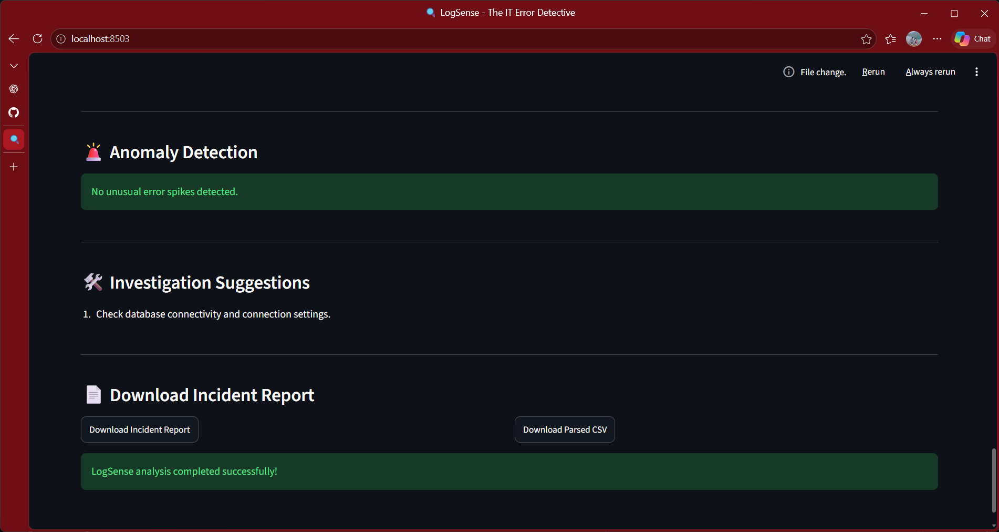

# 🔍 LogSense – The IT Error Detective

**A Python-based log analysis dashboard that helps identify application errors, analyze log patterns, and investigate potential issues.**

## 📊 Application Dashboard


## 🔎 Analysis and Investigation



## 🚀 Project Overview

LogSense is an interactive log analysis application developed using Python and Streamlit.

It accepts application log files, extracts structured information, identifies errors and warnings, visualizes log patterns, and provides investigation suggestions.

## ✨ Features

- Upload `.log` and `.txt` files.
- Parse and validate log entries.
- Identify malformed log entries.
- Display total logs, errors, warnings, and invalid entries.
- Visualize log severity distribution.
- Identify frequently occurring errors.
- Display error timelines.
- Detect possible unusual error activity.
- Generate rule-based investigation suggestions.
- Download incident reports in TXT format.
- Export parsed log entries as CSV.

## 🛠️ Technologies Used

- Python
- Streamlit
- Pandas
- Matplotlib
- Pytest
- Git and GitHub

## 📁 Project Structure

```text
logsense/
│
├── app.py
├── README.md
├── requirements.txt
├── .gitignore
│
├── data/
│   └── sample.log
│
├── src/
│   ├── __init__.py
│   ├── log_parser.py
│   └── log_analyzer.py
│
├── tests/
│   ├── test_log_parser.py
│   └── test_log_analyzer.py
│
└── screenshots/
    ├── dashboard.png
    └── analysis.png
```

## 💻 Installation

**1. Clone the repository**

```bash
git clone https://github.com/nivodhini25-ux/logsense.git
```

**2. Open the project folder**

```bash
cd logsense
```

**3. Create a virtual environment**

```bash
python -m venv .venv
```

**4. Activate the virtual environment (Windows)**

```powershell
.\.venv\Scripts\Activate.ps1
```

**5. Install dependencies**

```bash
python -m pip install -r requirements.txt
```

## ▶️ Run the Application

```bash
python -m streamlit run app.py
```

Open the local URL displayed in your terminal to access LogSense.

## 📝 Supported Log Format

LogSense currently supports this text-based log format:

```text
2026-11-15 09:17:05 ERROR Database connection failed
```

The format contains:

- Timestamp: `YYYY-MM-DD HH:MM:SS`
- Log level: `INFO`, `WARNING`, `ERROR`, or `DEBUG`
- Message: Description of the event

The application accepts UTF-8 encoded `.log` and `.txt` files up to 5 MB.

## 🧪 Run Automated Tests

Execute the following command:

```bash
python -m pytest -q
```

## ⚠️ Limitations

- Supports one predefined text-log format.
- Anomaly detection uses a simple statistical rule.
- Investigation suggestions are based on predefined keyword rules.
- Suggested causes are not confirmed root causes.
- Does not provide real-time production monitoring.

## 🔮 Future Enhancements

- Support JSON log files.
- Improve anomaly detection.
- Add more investigation rules.
- Introduce PDF incident report generation.
- Add additional log visualizations.

## 👩‍💻 Author

Developed as a Python Data Analytics project.

**GitHub Repository:**  
https://github.com/nivodhini25-ux/logsense
